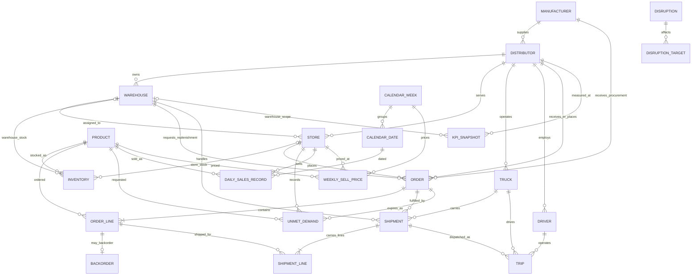

# Supply Chain Digital Twin Data Model

The Phase 2 schema is defined in SQLAlchemy 2.x models under `backend/app/models/`. Alembic revision `6712d88a6970` creates the schema and capacity trigger; `a48ff2a5e24c` sets fixed precision for prices and unmet-demand quantities.

## Relationship and integrity notes

- Each distributor references its manufacturer. Each warehouse, store, truck, and driver belongs to a distributor. A store's assigned warehouse must belong to the same distributor; the composite foreign key enforces this.
- Order flows are represented with typed nullable foreign keys and a check constraint, not generic `entity_type/entity_id` references: store order (`store -> distributor`), procurement (`distributor -> manufacturer`), and warehouse replenishment request (`warehouse -> distributor`). Composite foreign keys ensure the participating store or warehouse belongs to the destination distributor, and procurement is to the distributor's manufacturer.
- Shipments have explicit foreign keys for their origin and destination. Shipment lines refer to order lines and keep `quantity_shipped`, `quantity_delivered`, and computed `quantity_in_transit` separate from on-hand inventory. Backorder rows separately track quantities still owed; when a backorder expires, `unmet_demand` records the unfulfilled quantity.
- Outstanding backorder quantity is the order-line requested amount minus fulfilled amount and the sum of that line's in-transit shipment quantities. The backorder row stores the amount currently owed and can be reduced as further shipments are dispatched.
- An inventory row has exactly one location, a warehouse or a store. Partial unique indexes ensure one row per product/location. Distributor inventory is derived as the sum of its warehouse inventory; no duplicate distributor stock row exists. Store stock is separate.
- Disruptions use `disruption_targets`, a normalized association with typed foreign keys and an exactly-one-target check. This supports manufacturers/distributors (supplier failures), warehouses, stores (demand spikes), and trucks (transport delays) while retaining database referential integrity.
- Calendar dates and weeks are separate from product/store sales and weekly sell prices. M5 identifiers use their source column names (`d`, `wm_yr_wk`, `item_id`, `dept_id`, `cat_id`, `store_id`, `state_id`). Historical fact rows are not stored on Product or Store.
- KPI rows can be warehouse-scoped or distributor-scoped. `total_profit` is a generated column: revenue minus procurement, transport, fuel, salary, and operating expenses. Warehouse snapshot costs must be allocated once; a distributor snapshot is an aggregate view and must not be added to its warehouse snapshots when reporting total costs.

## Warehouse capacity

`storage_capacity` is measured in common storage units. Each product contributes `quantity_on_hand * storage_units_per_item`; store inventory and in-transit shipment quantities do not consume warehouse capacity. A PostgreSQL trigger locks the warehouse row before summing stock during inventory inserts/updates and warehouse capacity changes. The parent-row lock serializes concurrent stock changes so two transactions cannot each pass based on stale totals. Product storage-unit conversion cannot change after inventory records exist. SQLite metadata has equivalent triggers for unit tests; the production constraint is installed by the Alembic migration.

## Applying the schema

Run `alembic upgrade head` from `backend/` with `DATABASE_URL` set to the target PostgreSQL database. Reverse the initial schema only when intentionally removing all Phase 2 tables with `alembic downgrade base`.
